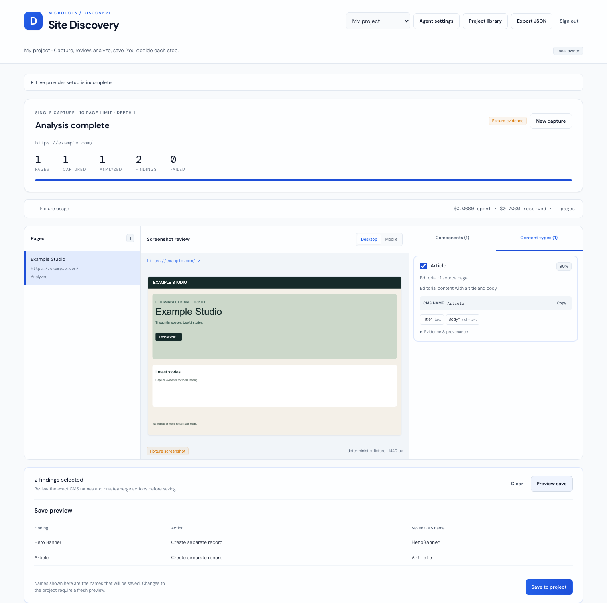
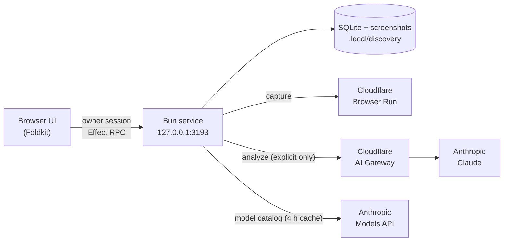

# Site Discovery

Capture a website's pages, let Claude identify its reusable components and content types, and save the results as a reviewable CMS model.

Site Discovery is a local, single-owner app. You give it a URL, a list of URLs, a sitemap or a domain to crawl. It captures each page with **Cloudflare Browser Run** at desktop and mobile widths, and only analyzes pages you explicitly select, using **Claude through Cloudflare AI Gateway**. Findings are mapped to names for AEM, Optimizely, Sitecore or a generic CMS, and nothing is saved until you review and confirm it.

> **Cloudflare is required for live use.** Capture uses the Browser Run REST API and analysis goes through an authenticated AI Gateway. There is no fallback provider. A built-in **fixture mode** lets you try the full workflow without any accounts.





## Features

- **Four ways to choose pages:** a single URL, a newline-separated batch, a same-origin crawl (1–3 link hops) or a sitemap, up to 50 pages.
- **Capture never calls a model.** Analysis runs only when you click **Analyze selected pages**.
- **Spending limits that fail closed.** Per-run and monthly USD limits are reserved atomically before every model call, and uncertain costs stay counted.
- **Durable runs.** Work is owned by the service and survives a closed tab or a restart. Interrupted calls are flagged **requires retry** and never resent silently.
- **Reviewed, transactional saves.** Duplicate handling (merge or keep both), CMS naming previews, save receipts and a JSON export.

## Requirements

| Need | For |
|---|---|
| [Bun](https://bun.sh) 1.4 or later | Everything |
| Cloudflare account with [Browser Run](https://developers.cloudflare.com/browser-run/) | Live capture |
| Cloudflare [AI Gateway](https://developers.cloudflare.com/ai-gateway/) with authentication turned on | Live analysis |
| [Anthropic API key](https://console.anthropic.com/) | Model catalog and live analysis |
| Chromium for Playwright (`bunx playwright install chromium`) | Only `bun run test:browser` |

## Quick start (no accounts)

```sh
git clone https://github.com/qdhenry/site-discovery.git
cd site-discovery
bun install
DISCOVERY_FIXTURES=1 DISCOVERY_MODEL_CATALOG_FIXTURE=1 bun run dev
```

1. Open http://127.0.0.1:3193/.
2. Paste the contents of `.local/discovery/owner-token` into the sign-in form. The service creates this file on first start (mode `0600`).
3. Choose **Fixture** in the capture form and run a capture.

Fixture runs are labeled as such and make no network or provider calls.

## Cloudflare and Anthropic setup

1. **Account ID.** Copy it from the Cloudflare dashboard sidebar.
2. **Browser Run token.** [Create a custom API token](https://developers.cloudflare.com/fundamentals/api/get-started/create-token/) with the **Account · Browser Run · Edit** permission.
3. **AI Gateway.** Create a gateway. In its **Settings**, select **Create authentication token** (the **AI Gateway Run** permission), then turn on **Authenticated Gateway**. Note the gateway ID.
4. **Anthropic key.** Create one in the Anthropic Console. The service uses it directly with the Anthropic Models API to load model information, and sends it per analysis request through the gateway (`x-api-key`). Gateway-stored keys (BYOK) and unified billing are not used.
5. **Configure.** Copy `environment.example` to `.env` and fill it in. Bun loads `.env` automatically.

   ```sh
   cp environment.example .env
   ```

6. **Set spending limits**, either in `.env` or later in **Agent settings**. Live analysis stays blocked until all three are positive.
7. Run `bun run dev`, sign in and capture a live page.

## Configuration

Credentials and gateway routing stay on the service. Model settings and catalog information are available in the owner-authenticated UI.

| Variable | Meaning |
|---|---|
| `CLOUDFLARE_ACCOUNT_ID` | Cloudflare account for capture and gateway routing |
| `CLOUDFLARE_BROWSER_API_TOKEN` | Browser Run credential (`Browser Run - Edit`) |
| `CLOUDFLARE_AI_GATEWAY_ID` | Gateway ID |
| `AI_GATEWAY_API_TOKEN` | Gateway credential, sent as `cf-aig-authorization` |
| `ANTHROPIC_API_KEY` | Anthropic Models API and Claude credential, sent as `x-api-key` |
| `DISCOVERY_MODEL` | Initial model, default `claude-sonnet-4-6` |
| `DISCOVERY_RUN_LIMIT_USD` | Initial per-run limit |
| `DISCOVERY_MONTHLY_LIMIT_USD` | Initial monthly limit |
| `DISCOVERY_ATTEMPT_RESERVATION_USD` | Initial reservation per Claude attempt. It must cover the bound the service calculates |
| `DISCOVERY_STATE_DIR` | Private storage directory, default `.local/discovery` |
| `DISCOVERY_OWNER_TOKEN` | Optional sign-in token (at least 24 characters) instead of a generated one |
| `DISCOVERY_FIXTURES` | Set to exactly `1` to enable fixture mode |
| `DISCOVERY_MODEL_CATALOG_FIXTURE` | Set to exactly `1` with `DISCOVERY_FIXTURES=1` for an explicitly labeled offline model catalog; it cannot authorize live analysis |

The model and the three limits only set the initial **Agent settings**. Once you save settings in the UI, the saved values take precedence. See [docs/agent-settings.md](docs/agent-settings.md).

Model availability, names, limits and supplied capabilities come from the **Anthropic Models API**, cached durably for four hours. **Refresh model catalog** requests fresh metadata without running analysis. Expired data remains visible if refresh fails, but blocks new live analysis until refreshed. Models unsupported by the installed adapter or pricing metadata are shown as unavailable; cost estimates use bundled Pi AI 1.0.3 pricing, because the API does not supply prices.

Settings changes apply the next time you start or retry analysis. Running analysis retains its admitted settings and model information across all selected pages.

## Security model

- The service binds to loopback (`127.0.0.1`) only. It is not designed to be exposed on a network or deployed.
- One owner signs in with the local token. Sessions are HttpOnly and SameSite=Strict, last 12 hours, and end when the service restarts.
- Host, origin and session are checked before any RPC is decoded. The only foreign origin allowed is the development mini-host at `http://localhost:5193`.
- Screenshots and rendered DOM are treated as untrusted model input. Model output must pass strict schemas before it becomes a finding.
- Private and local URLs are refused, DNS results are pinned per socket, and every redirect is re-validated.

To report a vulnerability, see [SECURITY.md](SECURITY.md).

## Development

| Command | What it does |
|---|---|
| `bun run dev` | Build the UI and start the service |
| `bun run dev:bundle` + `bun run dev:service` | Watch mode, in two terminals |
| `bun run check` | Typecheck plus all unit and service tests |
| `bun run build` | Build `dist/` |
| `bun run test:browser` | End-to-end Playwright run in fixture mode against a temporary database |

```
src/        Browser UI: Foldkit app, Effect RPC contract, custom elements
service/    Bun service: auth, RPC handlers, durable engine, providers, SQLite
packages/   Vendored MicroDots runtime, element, theme, catalog, Vite plugin
mini-host/  Optional development host on :5193
tests/      Playwright browser proof
docs/       Architecture, contracts, settings and behavior reference
```

## Documentation

- [Run locally](docs/run-local.md)
- [Agent settings](docs/agent-settings.md)
- [How it works](docs/how-it-works.md): workflow, persistence, budgets and recovery
- [Contracts and transport](docs/contracts.md)
- [Design decisions](docs/design-decisions.md)
- [Architecture diagram](docs/architecture.html)

## Contributing

See [CONTRIBUTING.md](CONTRIBUTING.md).

## License

[Apache License 2.0](LICENSE).
